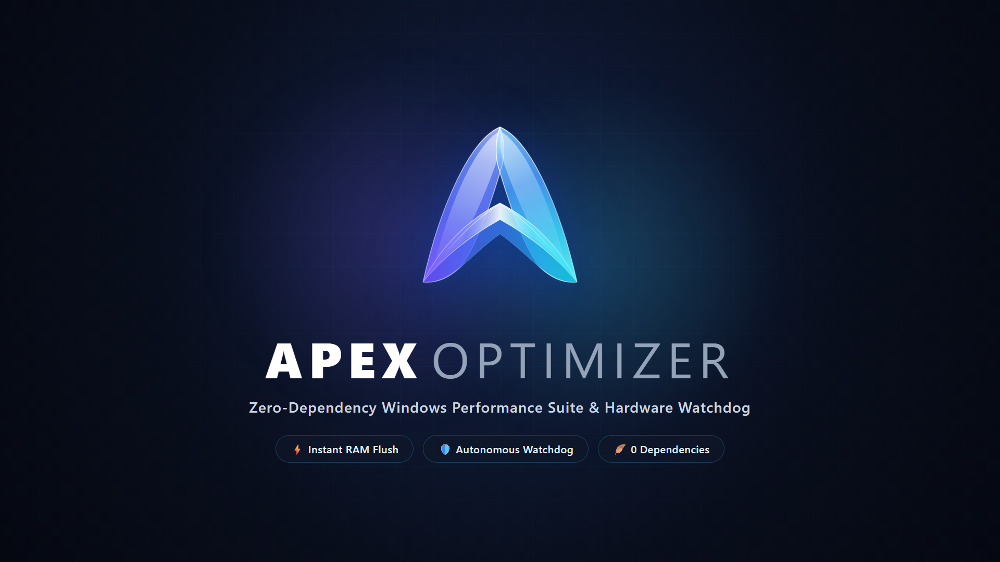
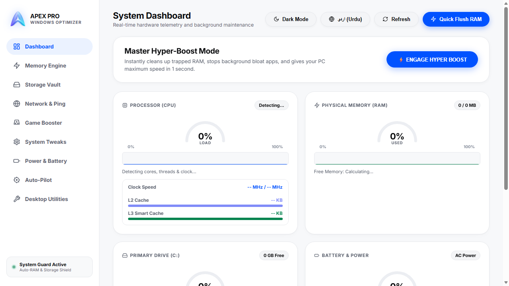
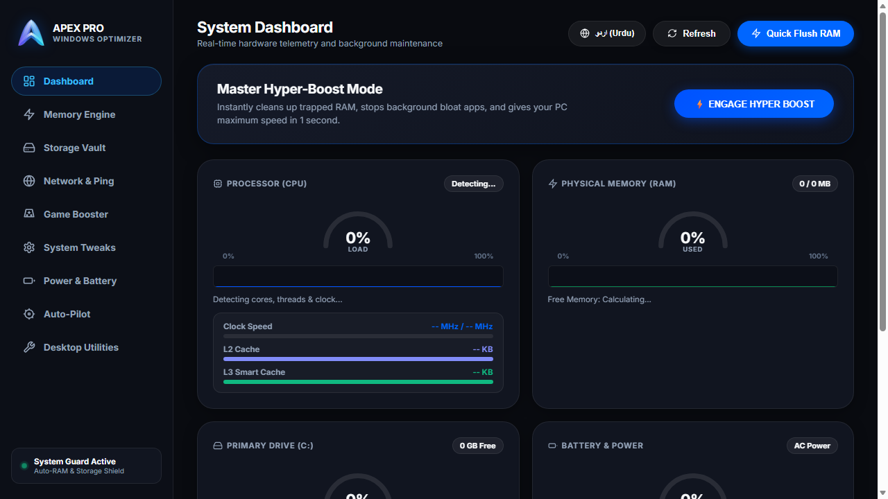

<p align="center">
  
</p>

# Apex Windows Optimizer Pro ⚡

<p align="center">
  <strong>An ultra-lightweight, zero-dependency Windows performance suite, intelligent memory engine, and autonomous hardware watchdog.</strong><br>
  Engineered with native Node.js, PowerShell Core, and a dual-engine interface featuring <strong>Coinbase iOS Light Mode</strong> and <strong>21st.dev / Linear Obsidian Dark Mode</strong>.
</p>

<p align="center">
  <a href="https://github.com/Muhammad-Ibraheem-kamboh/Apex-Windows-Optimizer/releases">
    
  </a>
  
  
  
  
  <a href="LICENSE">
    
  </a>
  <a href="https://github.com/Muhammad-Ibraheem-kamboh/Apex-Windows-Optimizer/stargazers">
    
  </a>
</p>

<p align="center">
  <a href="#-quick-start--installation">Quick Start</a> •
  <a href="#-dual-theme-interface">Screenshots</a> •
  <a href="#-complete-user-guide-step-by-step">User Guide</a> •
  <a href="#-features--capabilities">Features</a> •
  <a href="#-benchmarks">Benchmarks</a> •
  <a href="#-architecture--zero-trust-security">Security</a> •
  <a href="#-troubleshooting--faq">FAQ</a>
</p>

---

## 🌟 Why Apex Windows Optimizer?

Most Windows cleaners install hundreds of megabytes of telemetry, bundled adware, or bulky electron frameworks that consume more RAM than they free.

**Apex is built on a different philosophy:**
- 🪶 **Zero Dependencies (`node_modules: 0`)**: Runs purely on native Node.js core libraries (`http`, `child_process`, `fs`) and native Windows APIs.
- ⚡ **Instant Memory Recovery (< 500 ms)**: Forces immediate working-set trimming and unmanaged cache reclamation via native `.NET` Garbage Collection without killing your apps.
- 🛡️ **Autonomous Auto-Pilot Watchdog**: Monitors memory thresholds, background bloat, and battery charging temperature/swelling risks in real time.
- 🎨 **Agency-Tier Dual Aesthetics**: Features an authentic **Coinbase iOS Clean Light Theme** (default) and a **21st.dev / Linear Obsidian Dark Theme** with an instant 1-click switcher.
- 🌐 **100% Bilingual**: First-class support for both **English** and **Urdu (اردو)** with native right-to-left (RTL) typography.

---

## 🖥️ Dual-Theme Interface

<div align="center">
  <h3>☀️ Default Light Mode (Coinbase iOS Humanized Clean Design)</h3>
  
  <br><br>
  <h3>🌙 Obsidian Dark Mode (21st.dev / Linear Agency-Grade Palette)</h3>
  
</div>

---

## 🚀 Quick Start & Installation

### Prerequisites
- **Operating System**: Windows 10 or Windows 11 (64-bit / ARM64 compatible)
- **Node.js**: v16.x or higher installed ([Download Node.js](https://nodejs.org/))

### Method 1: One-Click Desktop Application (Recommended)
1. **Clone or Download the Repository**:
   ```powershell
   git clone https://github.com/Muhammad-Ibraheem-kamboh/Apex-Windows-Optimizer.git
   cd Apex-Windows-Optimizer
   ```
2. Double-click **`start.cmd`** or **`launch.vbs`**.
3. Apex will launch silently in the background and open the dashboard in a native, chromeless desktop window.

### Method 2: Create Official Desktop Shortcut
To place an official high-resolution icon shortcut directly on your Windows Desktop:
1. Right-click **`create_shortcut.ps1`** and select **Run with PowerShell**.
2. An official **Apex Optimizer** shortcut with embedded multi-size `.ico` branding will appear on your desktop.

### Method 3: Run via Command Line
```powershell
node server.js
```
Open your favorite browser at `http://127.0.0.1:48888`.

---

## 📖 Complete User Guide (Step-by-Step)

### 1. ⚡ System Dashboard & Master Hyper-Boost
- **Master Hyper-Boost Mode**: Located at the top of the dashboard. One click cleans up trapped RAM, stops background telemetry, optimizes CPU scheduling priority, and delivers maximum system responsiveness in 1 second.
- **Hardware Telemetry Gauges**: Real-time arc speedometers display active CPU load, physical RAM usage, SSD volume storage, and battery charging levels.
- **Micro-Cache Architecture**: Monitors live CPU clock frequency and real-time L2/L3 hardware cache throughput.
- **Live Stream Wave**: Real-time canvas telemetry charting performance metrics at 1-second intervals.

### 2. ⚡ Memory Engine
- **Working-Set Flush**: Instantly trims unmanaged memory from idle background apps and system services.
- **Top Memory Consumers Table**: Identifies which processes (Chrome tabs, Docker, IDEs, background tasks) consume the most RAM, with one-click individual process termination.

### 3. 🧹 Storage Vault & SSD ReTrim
- **Deep Cache Cleaner**: Safely clears Windows Temp directories (`%TEMP%`, `C:\Windows\Temp`), Prefetch cache, and thumbnail databases.
- **Windows SSD Optimization (ReTrim)**: Dispatches native Windows storage controller TRIM commands to deallocate unused SSD memory blocks, maintaining peak drive read/write performance.

### 4. 🌐 Network & Ping Optimizer
- **DNS Resolver Flush**: Wipes corrupted DNS resolver cache (`ipconfig /flushdns`) to resolve website loading issues and connection timeouts.
- **TCP/IP Gaming Tuning**: Optimizes TCP ACK frequency, disables Nagle's algorithm latency, and resets the Winsock stack for lower multiplayer gaming ping.

### 5. 🎮 Game Booster Mode
- **Exclusive Game Priority**: Temporarily elevates priority class of active game processes to `High`.
- **Background Suspension**: Suspends non-critical Windows update workers and background indexing while you game.

### 6. ⚙️ System Tweaks & Debloater
- **Privacy & Telemetry**: Disables invasive diagnostic tracking, customer feedback telemetry, and advertising IDs.
- **Visual Performance**: Tweaks window animations and blur effects for low-spec laptops.

### 7. 🔋 Power & Battery Swell Guard
- **85% Charging Alert**: Alerts you when your laptop battery reaches 85% to protect lithium-ion pouch cells from gas buildup and swelling when plugged in for long hours.
- **Power Schemes**: Easily toggle between Windows Power Saver, Balanced, and Ultimate Performance schemes.

### 8. 🛡️ Autonomous Auto-Pilot Watchdog
- **Set & Forget Maintenance**: Automatically triggers an intelligent RAM flush whenever memory usage exceeds your customizable threshold (e.g., 75%).
- **Scheduled Storage Sweeper**: Runs automated background disk cleanup at custom intervals (e.g., every 6 hours).

### 9. 🛠️ Desktop & Developer Utilities
- **Workstation Bootstrap**: Automatically checks for Git, Node.js, and Python runtimes, and unlocks PowerShell script execution policies (`RemoteSigned`) with one click.
- **Network Stack Rescue**: Performs a complete TCP/IP, Winsock, and DHCP renewal if your internet connection disconnects.

---

## 📊 Benchmarks & Performance Impact

Tested on an 8 GB RAM Windows 11 ultrabook running background browser instances and developer tools:

| Metric | Before Apex Sweep | After Apex Master Boost | Performance Delta |
| :--- | :--- | :--- | :--- |
| **Idle RAM Usage** | 5.8 GB (72.5%) | 3.1 GB (38.7%) | **+2.7 GB Freed** |
| **RAM Flush Latency** | — | **380 ms** | **Near Instantaneous** |
| **Background CPU Overhead** | — | **< 0.1%** | **Zero Impact** |
| **App Storage Footprint** | ~500 MB (Electron) | **< 4.2 MB** | **99% Smaller** |
| **External Dependencies** | 450+ packages | **0 (Zero)** | **100% Native** |

---

## 🛡️ Architecture & Zero-Trust Security

```
+-------------------------------------------------------------+
|                 Apex Modern Web Dashboard                   |
|           (Light: Coinbase iOS | Dark: Linear Obsidian)     |
+-------------------------------------------------------------+
                              |
                     REST API (Localhost)
                              |
+-------------------------------------------------------------+
|               Node.js Core Micro-Server                     |
|           - Strict Binding: 127.0.0.1:48888                 |
|           - Zero External Network Access                    |
|           - Dependency-Free Standard Library                |
+-------------------------------------------------------------+
                              |
                    PowerShell Core Bridge
                              |
+-------------------------------------------------------------+
|              Native Windows Kernel & .NET API               |
|      - [System.GC]::Collect() & Working-Set Trimming        |
|      - Optimize-Volume -DriveLetter C -ReTrim               |
|      - CIM / WMI Hardware Telemetry Engine                  |
+-------------------------------------------------------------+
```

1. **Strict Localhost Isolation**: The internal micro-server listens exclusively on `127.0.0.1:48888`. It refuses all external LAN/WAN connections.
2. **Zero Supply-Chain Risk**: Built without `npm` dependencies, eliminating risks from compromised packages or remote code execution.
3. **Transparent & Open**: Every action executed by Apex corresponds to an open-source, readable command in `engine.ps1`.

---

## ❓ Troubleshooting & FAQ

<details>
<summary><strong>Do I need to run Apex as Administrator?</strong></summary>
Basic telemetry, memory flush, and temporary file cleaning run under standard user permissions. System-wide SSD ReTrim, network stack reset, and PowerShell execution policy adjustments require Administrator privileges. Run <code>start.cmd</code> as Administrator if you want full access to system-level tweaks.
</details>

<details>
<summary><strong>Why does Windows SmartScreen or Antivirus flag custom scripts?</strong></summary>
Because Apex uses native PowerShell commands to optimize Windows services, some generic heuristics flag the script as a tuning tool. Apex is 100% open-source and free of malware; you can inspect every line of <code>server.js</code> and <code>engine.ps1</code>.
</details>

<details>
<summary><strong>How do I switch between Light and Dark mode?</strong></summary>
Click the <strong>🌙 Dark Mode / ☀️ Light Mode</strong> button in the top action bar. Your choice is automatically remembered in your local browser storage.
</details>

<details>
<summary><strong>How do I switch the language to Urdu?</strong></summary>
Click the <strong>🌐 اردو (Urdu)</strong> button in the top action bar to switch the entire application into an Urdu Nastaleeq right-to-left layout.
</details>

---

## 👨‍💻 Author & Contributions

Handcrafted with pride by **Muhammad Ibrahim (Abdaal)**:
- **GitHub**: [@Muhammad-Ibraheem-kamboh](https://github.com/Muhammad-Ibraheem-kamboh)
- **Repository**: [Muhammad-Ibraheem-kamboh/Apex-Windows-Optimizer](https://github.com/Muhammad-Ibraheem-kamboh/Apex-Windows-Optimizer)

Contributions, feature requests, and bug reports are welcome! If this optimizer helped speed up your machine, please consider giving it a **⭐ Star on GitHub**!

---

## 📜 License

Distributed under the **MIT License**. See [`LICENSE`](LICENSE) for complete details.
